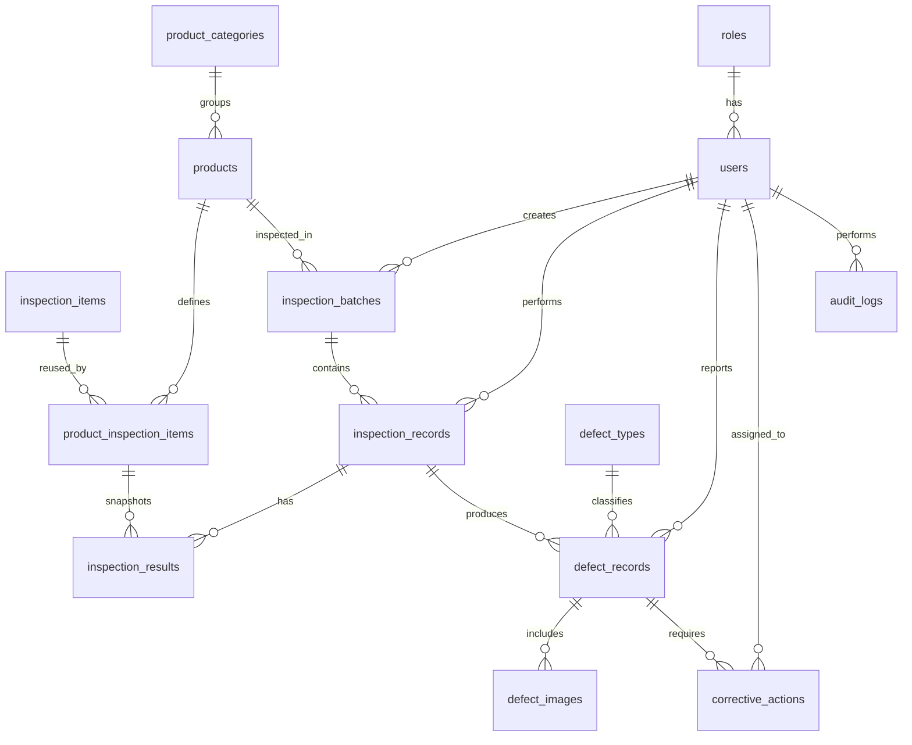

# QMS ERD 與資料模型

## 1. 資料庫設定

```sql
CREATE DATABASE qms_db
  CHARACTER SET utf8mb4
  COLLATE utf8mb4_unicode_ci;
```

正式環境使用 Django Migrations 建立與變更資料表。

## 2. 核心關係



## 3. 資料表說明

### roles / users

- `roles`：角色名稱與說明。
- `users`：登入帳號、姓名、Email、角色與啟用狀態。
- 密碼必須由 Django 儲存雜湊值，不得保存明文。

### product_categories / products

- 一個分類可包含多個產品。
- `products.product_code` 必須唯一。
- 產品可停用，但不應刪除已產生歷史檢驗紀錄的產品。

### inspection_items / product_inspection_items

- `inspection_items` 是可重複使用的檢驗項目。
- `product_inspection_items` 是產品檢驗標準設定的中間表。
- 中間表應包含 `is_required`、`sort_order`，並可擴充標準上下限、標準值與版本欄位。
- 同一產品不可重複掛載同一檢驗項目。

建議欄位：

```text
product_item_id
product_id
item_id
item_type
standard_min
standard_max
standard_value
inspection_method
is_required
sort_order
```

### inspection_batches / inspection_records / inspection_results

- `inspection_batches`：待檢驗的產品批次與數量。
- `inspection_records`：某批次的一次檢驗作業與檢驗人員。
- `inspection_results`：檢驗作業中各項目的實際結果。
- `inspection_results` 應連到 `product_inspection_items`，並保留標準快照。

建議 `inspection_results` 欄位：

```text
result_id
inspection_id
product_item_id
measured_value
measured_text
result
standard_min_snapshot
standard_max_snapshot
standard_value_snapshot
inspection_method_snapshot
remark
```

### defect_types / defect_records / defect_images

- `defect_types`：可維護的不良類型。
- `defect_records`：與檢驗紀錄關聯的不良品或缺失。
- `defect_images`：圖片實體存放於 Media Storage，資料庫僅保存路徑與上傳時間。

### corrective_actions

- 一筆不良紀錄可有多個改善措施。
- 改善措施包含負責人、期限、狀態與完成時間。
- 逾期判斷應以 `due_date` 與狀態為依據。

### audit_logs

建議欄位：

```text
audit_id
user_id
action
table_name
record_id
old_data JSON
new_data JSON
created_at
```

稽核紀錄的 `user_id` 可為 NULL，以保留帳號刪除後的歷史紀錄。

## 4. 索引與限制

- 使用唯一鍵：帳號、角色名稱、產品代碼、批次代碼、不良類型名稱。
- 建立批次的產品與狀態索引。
- 建立檢驗紀錄的批次、檢驗人員索引。
- 建立不良紀錄的檢驗紀錄與狀態索引。
- 建立改善措施的狀態與期限索引。
- 外鍵刪除策略需保護品質歷史資料；只對附屬圖片與檢驗結果使用 CASCADE。

## 5. 生命週期

```text
產品：ACTIVE → INACTIVE
批次：PENDING → INSPECTING → COMPLETED
                     └──────→ CANCELLED
不良：NEW → CONFIRMED → PROCESSING → RESOLVED → CLOSED
改善：PENDING → PROCESSING → COMPLETED
                         └──────→ CANCELLED
```
